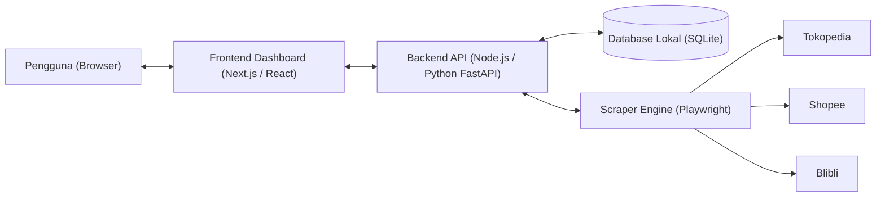
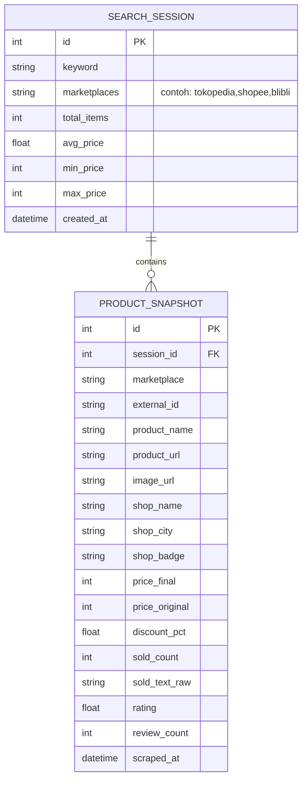

# Product Requirements Document (PRD): Marketplace Analytic Dashboard

## 1. Ringkasan Proyek (Executive Summary)
**Marketplace Analytic Dashboard** adalah aplikasi web berbasis lokal (*local-first web application*) untuk melakukan riset produk, pemantauan harga, analisis diskon penjual, sebaran kota penjual, dan performa penjualan kompetitor di tiga marketplace utama Indonesia: **Shopee, Tokopedia, dan Blibli**.

Aplikasi ini memungkinkan pengguna memasukkan kata kunci pencarian (contoh: *"fillet dada ayam"*), memilih marketplace target, mengambil data secara otomatis, menyimpannya ke dalam database lokal untuk pelacakan riwayat (*historical tracking*), serta menyajikan metrik analitik visual dan tabel interaktif.

---

## 2. Tujuan & Manfaat Utama
1. **Riset Produk & Kompetitor Cepat**: Mengumpulkan data puluhan hingga ratusan produk dari berbagai marketplace dalam satu layar tanpa perlu membuka tab satu per satu.
2. **Analisis Strategi Harga & Diskon**: Mengetahui harga rata-rata pasar, harga termurah/termahal, serta seberapa besar diskon yang biasa dipasang oleh penjual (*seller discount*).
3. **Analisis Wilayah / Kota Penjual**: Memetakan kota asal penjual untuk menganalisis persaingan per wilayah (sangat penting untuk produk segar/*frozen* seperti *fillet dada ayam* yang mengandalkan pengiriman instan/lokal).
4. **Penyimpanan Riwayat (Historical Database)**: Menyimpan setiap sesi pencarian ke dalam database agar pengguna bisa melihat kembali data lama atau membandingkan perubahan harga dan penjualan dari waktu ke waktu.
5. **Visualisasi Metrik Lintas Platform**: Membandingkan performa dan rentang harga produk yang sama antara Shopee, Tokopedia, dan Blibli.

---

## 3. Arsitektur Sistem (Local Environment)

> [!TIP]
> Karena aplikasi dijalankan di **komputer lokal (Localhost)**, kita dapat memanfaatkan **Playwright Persistent Context (Profil Browser Lokal)**. Ini sangat menguntungkan untuk melewati proteksi login/anti-bot (khususnya di Shopee) karena sesi login Anda di browser profil khusus akan tersimpan otomatis.

### Rekomendasi Tech Stack:
- **Frontend & Backend Framework**: **Next.js (TypeScript)** + **Tailwind CSS** + **Recharts** (untuk grafik analitik) + **Lucide Icons**.
- **Database Lokal**: **SQLite** dengan **Prisma ORM** atau **Better-SQLite3** (Sangat ringan, berbentuk file `.db` langsung di dalam folder proyek tanpa perlu install server database terpisah, namun mudah di-upgrade ke PostgreSQL nantinya).
- **Scraper Engine**: **Playwright** (mendukung *Network Interception* untuk menangkap data JSON asli dari API internal Tokopedia, Shopee, dan Blibli saat halaman dimuat sehingga data jauh lebih akurat daripada sekadar membaca HTML).

---

## 4. Spesifikasi Data yang Diambil (Data Schema)

Setiap produk yang berhasil diambil dari hasil pencarian akan dinormalisasi ke dalam format standar berikut:

| Nama Field | Tipe Data | Deskripsi & Contoh |
| :--- | :--- | :--- |
| `marketplace` | `String` | Sumber platform: `tokopedia`, `shopee`, atau `blibli` |
| `product_name` | `String` | Nama lengkap produk (misal: *"Fillet Dada Ayam Fresh 1kg Tanpa Tulang"*) |
| `product_url` | `String` | Link langsung menuju halaman produk di marketplace |
| `image_url` | `String` | Thumbnail foto produk |
| `shop_name` | `String` | Nama toko penjual |
| `shop_city` | `String` | **Kota/Lokasi penjual** (misal: *"Jakarta Selatan"*, *"Kab. Tangerang"*, *"Surabaya"*) |
| `shop_badge` | `String` | Status toko jika ada (*Official Store / Mall / Power Merchant / Star+*) |
| `price_final` | `Integer` | Harga jual saat ini (setelah diskon), misal: `45000` |
| `price_original` | `Integer` | Harga asli sebelum diskon (harga coret), misal: `55000` |
| `discount_pct` | `Float` | Persentase diskon penjual (misal: `18.2%`) |
| `sold_count` | `Integer` | Estimasi angka total terjual (dinormalisasi dari teks seperti `"1rb+ terjual"` menjadi `1000`) |
| `rating` | `Float` | Rating produk/toko (skala `0.0` - `5.0`, misal: `4.9`) |
| `review_count` | `Integer` | Jumlah ulasan (jika tersedia di hasil pencarian) |
| `scraped_at` | `DateTime` | Waktu pengambilan data |

---

## 5. Fitur Utama & Kebutuhan Fungsional

### Modul 1: Pencarian & Kontrol Scraper
- **Input Kata Kunci**: Kolom pencarian (contoh: *"fillet dada ayam"*).
- **Pilihan Marketplace**: Checkbox untuk memilih **Tokopedia**, **Shopee**, dan/atau **Blibli**.
- **Pengaturan Pengambilan**: Pilihan jumlah halaman atau batas produk (misal: 20, 40, atau 60 produk per marketplace) dan urutan pencarian (*Paling Relevan* atau *Terlaris*).
- **Manajemen Sesi Browser (Khusus Shopee/Login)**: Tombol untuk membuka jendela browser profil lokal jika pengguna perlu login akun marketplace sekali di awal agar tidak terkena Captcha.

### Modul 2: Ringkasan Analitik & Metrik Tambahan (Dashboard Cards & Charts)
1. **Kartu Statistik Utama (Summary KPI Cards)**:
   - **Total Produk Terkumpul** & jumlah toko unik.
   - **Rata-rata Harga Pasar (Average Price)** beserta **Harga Termurah (Min)** & **Harga Termahal (Max)**.
   - **Estimasi Total Penjualan (Total Sold Volume)** & **Estimasi Omzet Pasar** (`Harga × Total Terjual`).
   - **Rata-rata Diskon Penjual**: Berapa persen produk yang menggunakan strategi harga coret dan rata-rata besaran diskonnya.
2. **Visualisasi Grafik (Charts)**:
   - **Perbandingan Harga Antar Marketplace (Bar Chart)**: Rata-rata harga terendah, median, dan tertinggi di Shopee vs Tokopedia vs Blibli.
   - **Distribusi Rentang Harga (Price Histogram)**: Melihat di rentang harga berapa mayoritas penjual memasang harga (misal: Rp40.000 - Rp50.000 paling ramai).
   - **Sebaran Kota Penjual Terbanyak (City Distribution Chart)**: Melihat kota mana yang paling banyak mendominasi suplai dan penjualan (sangat krusial untuk produk *frozen food* / segar seperti *fillet dada ayam* yang sensitif terhadap jarak pengiriman instan).
   - **Top 10 Produk / Toko Terlaris (Horizontal Bar Chart)**: Daftar toko beserta kotanya yang mendominasi penjualan untuk kata kunci tersebut.
   - **Korelasi Harga vs Penjualan (Scatter Plot)**: Melihat apakah harga lebih murah selalu menghasilkan penjualan lebih tinggi, atau apakah diskon besar berpengaruh signifikan.

### Modul 3: Tabel Data Produk Interaktif
- Menampilkan daftar seluruh produk lengkap dengan thumbnail foto, badge marketplace, **nama toko**, **kota penjual**, harga final, harga coret + badge `% diskon`, angka terjual, estimasi omzet, dan rating.
- **Fitur Filter Cepat**:
  - Filter berdasarkan Marketplace (Semua / Shopee / Tokopedia / Blibli).
  - **Filter Dropdown Kota Penjual** (misal: pilih hanya penjual dari *"Jakarta Barat"* atau *"Tangerang"* untuk membandingkan kompetitor satu wilayah).
  - Filter berdasarkan kata kunci nama produk atau nama toko.
  - Filter **Hanya Produk Diskon** (untuk menganalisis strategi promo penjual).
- **Fitur Sorting (Urutkan)**:
  - Berdasarkan **Total Terjual Tertinggi**, **Harga Termurah/Termahal**, **Diskon Terbesar (%)**, atau **Rating Tertinggi**.
- **Export Data**: Unduh hasil tabel ke format **CSV / Excel (.xlsx)**.

### Modul 4: Database & Riwayat Pencarian (History & Price Tracking)
- Setiap kali pengguna melakukan pencarian, sistem otomatis menyimpan **Sesi Pencarian (`SearchSession`)** beserta daftar produknya ke database SQLite.
- **Halaman / Sidebar Riwayat**:
  - Melihat daftar pencarian terdahulu (contoh: *"fillet dada ayam - 26 Okt 2026, 15:00"*).
  - Membuka kembali data hasil pencarian lama secara instan tanpa perlu melakukan *scraping* ulang.
  - **Perbandingan Antar Waktu (Snapshot Comparison)**: Membandingkan rata-rata harga dan total penjualan untuk kata kunci yang sama antara pencarian lama dan pencarian baru.
  - Fitur hapus riwayat pencarian yang sudah tidak diperlukan.

---

## 6. Struktur Database (Entity Relationship Diagram)

---

## 7. Tahapan Pengerjaan (Roadmap Implementasi)

1. **Tahap 1: Setup Proyek & Database Lokal**
   - Inisialisasi proyek web (Next.js + Tailwind CSS) dan database SQLite.
   - Pembuatan skema tabel `SearchSession` dan `ProductSnapshot`.
2. **Tahap 2: Pembuatan Mesin Scraper (Playwright Engine)**
   - Implementasi modul scraper **Tokopedia**, **Blibli**, dan **Shopee** (dengan dukungan *Persistent Browser Context* agar tahan Captcha/login).
   - Normalisasi format harga, diskon penjual, kota penjual, rating, dan konversi teks `"1rb+ terjual"` menjadi angka.
3. **Tahap 3: Pembuatan Backend API & Penyimpanan Riwayat**
   - Endpoint untuk menjalankan pencarian baru, menyimpan ke database, serta mengambil daftar riwayat pencarian.
4. **Tahap 4: Pembuatan Dashboard UI, Grafik Analitik & Tabel Produk**
   - Pembuatan halaman pencarian, kartu ringkasan KPI, 5 grafik visualisasi metrik, tabel interaktif (filter kota, marketplace, diskon & sort), serta fitur Export CSV/Excel.
5. **Tahap 5: Pengujian & Penyempurnaan**
   - Uji coba langsung menggunakan studi kasus pencarian **"fillet dada ayam"** di ketiga marketplace.
